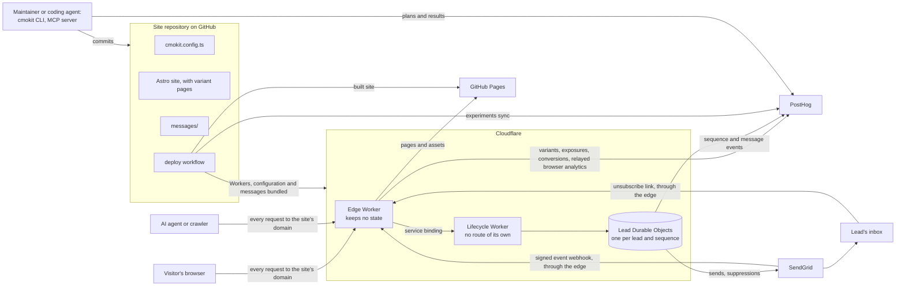
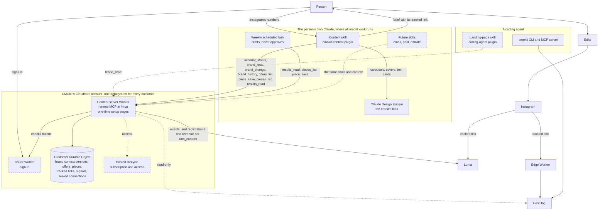
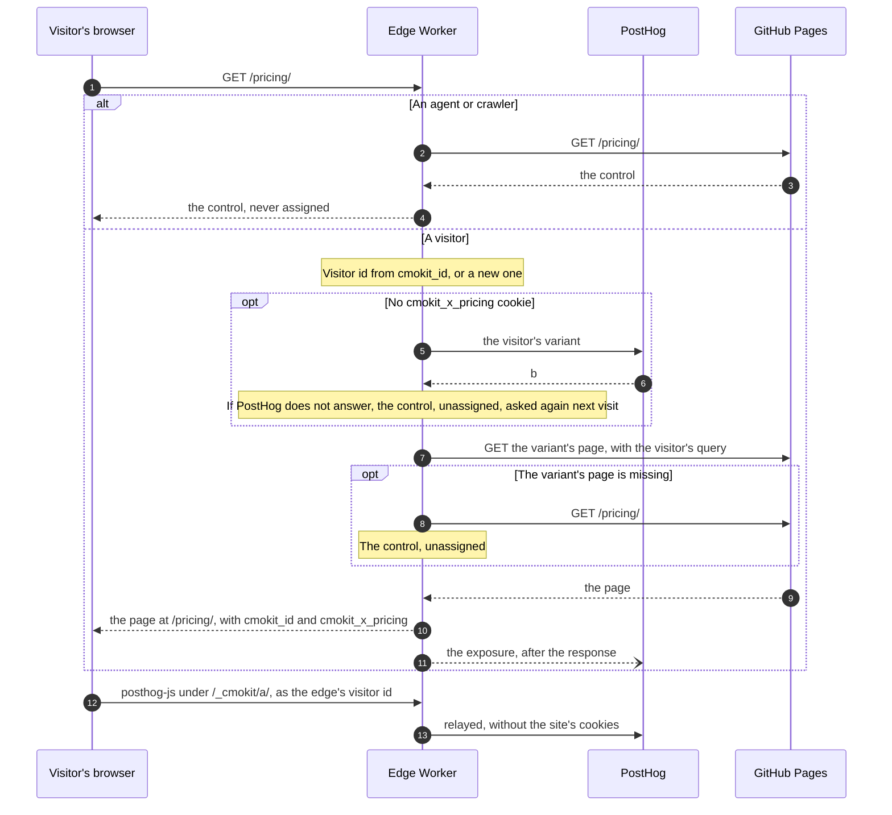
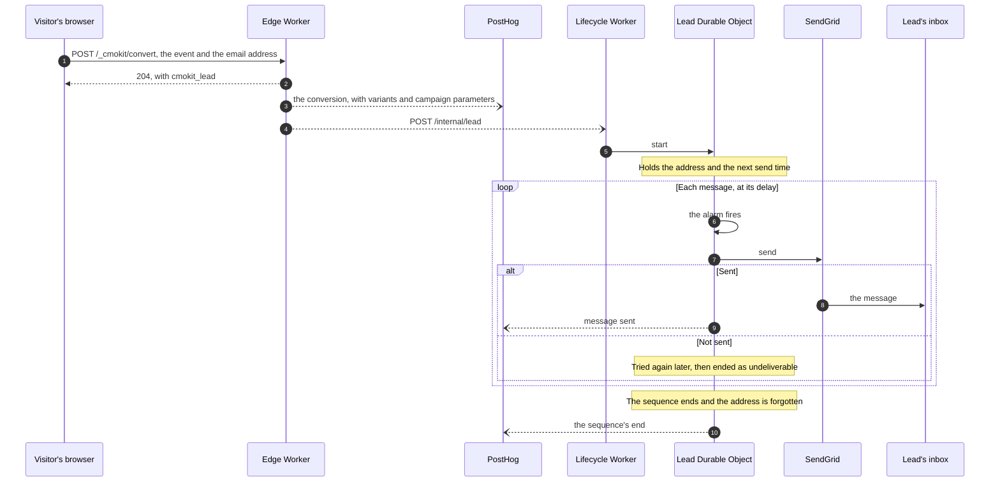
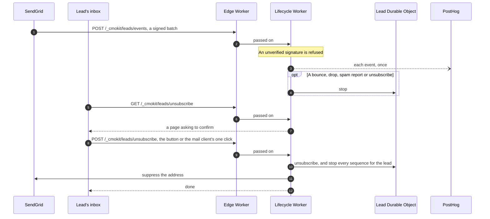
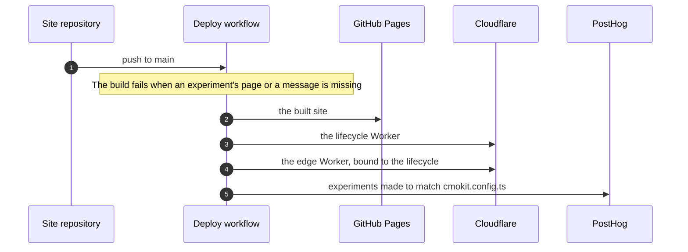

<!-- Generated by scripts/architecture.ts with `npm run docs`. Edit the script, not this page. -->

# How CMOkit fits around a site

A site that adopts CMOkit stays a static site on its own host, here GitHub Pages. CMOkit adds two
Cloudflare Workers: the edge, routed on the site's own domain in front of GitHub Pages, and the
lifecycle, which only the edge reaches. PostHog runs experiments and analytics, and SendGrid sends
email. The site's repository holds CMOkit's configuration, the variant pages and the messages, and
its deploy workflow makes the Workers and PostHog match it. Why each part is as it is lives in the
[decision records](../decisions/README.md); every variable and secret is in the
[deployment reference](../reference/deployment.md).

## Logical architecture

The site's DNS record points at GitHub Pages and is proxied by Cloudflare, so every request reaches
the edge first, and the edge's own fetches to the domain reach GitHub Pages. The edge answers HTML
pages, `/_cmokit/a/*`, `/_cmokit/convert`, `/_cmokit/leads/unsubscribe` and `/_cmokit/leads/events`; every other request
goes straight to GitHub Pages.

## Content, and the context the skills share

Dashed parts and calls are designed but not yet in this repository. Every model step runs in the
person's own Claude; the content server runs none. The server keeps one customer's records in that
customer's Durable Object, so every skill that connects reads the same brand context version. A
tracked link names the platform in `utm_source`, the promotable thing in `utm_campaign` and the
piece in `utm_content`, which is how a registration is counted against the piece that brought it.

## A visit to a page under experiment

A variant's own address redirects to its experiment's page, unless it carries `?cmokit_variant=`.

## A form that starts a sequence

A later conversion by the same visitor goes to `/internal/event`, and ends the sequence when it is
one of the sequence's stop events.

## SendGrid's events, and unsubscribing

## A deploy

The site goes first, so a variant's page exists before the edge can choose it, and the lifecycle
before the edge, whose binding names it.
